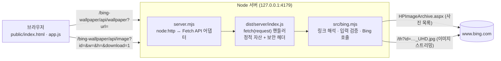

# 월페이퍼 스튜디오 (Bing Wallpaper Downloader)

> Bing 배경화면 링크를 붙여 넣어 미리 보고, 원하는 해상도의 JPG로 저장하는 웹 도구입니다.
> 공개 주소: `https://jong.3geun.com/bing-wallpaper/`

## 무엇을 하는가

- **오늘의 사진**: 버튼 하나로 Bing 홈페이지의 오늘 배경화면을 불러옵니다.
- **링크 붙여 넣기**: Bing 이미지 주소(`/th?id=OHR…`)나 홈페이지의 **사진 정보** 링크를 넣으면 해당 사진을 찾습니다. 사진 정보 링크는 최근 목록(최대 16일 전)에서 찾고, 오래된 사진은 이미지 주소를 사용합니다.
- **해상도 선택**: **원본**은 Bing의 UHD 파일을, 다른 옵션은 요청한 가로·세로(64~3840px)에 맞춰 Bing이 변환한 JPG를 내려받습니다. 비율이 다르면 일부가 잘릴 수 있습니다.
- 지원 범위: Bing 홈페이지 배경화면만 다룹니다. 일반 이미지 검색 결과와 Windows 추천(Spotlight) 사진은 지원하지 않습니다.

## 아키텍처

외부 의존성 없이 Node.js 22 표준 기능(`fetch`, `Request`/`Response`, `node:http`)만 사용합니다. 서버는 Bing API를 대신 호출하는 **얇은 프록시**로, 브라우저가 Bing에 직접 접근할 때의 CORS·다운로드 파일명 문제를 해결하고 입력을 검증합니다.



| 파일           | 역할                                                                                                                                                                          |
| -------------- | ----------------------------------------------------------------------------------------------------------------------------------------------------------------------------- |
| `src/bing.mjs` | Bing 링크를 해석해 이미지 ID를 찾고(`/th?id=`, 사진 정보 링크의 날짜·검색어), 최근 목록 API에서 제목·저작권·날짜를 읽습니다. 이미지 요청은 Bing 응답을 그대로 스트리밍합니다. |
| `build.mjs`    | `public/` 자산과 `bing.mjs`를 하나의 `fetch` 핸들러 모듈(`dist/server/index.js`)로 묶습니다. 같은 모듈을 서버리스 런타임에도 올릴 수 있는 형태입니다.                         |
| `server.mjs`   | Node `http` 요청을 표준 `Request`로 바꿔 핸들러에 넘기고, 응답 본문을 스트림으로 전달합니다.                                                                                  |
| `public/`      | 화면(HTML·CSS·JS). 붙여 넣기, 미리보기, 해상도 선택, 다운로드 UI                                                                                                              |

**보안·안정성**

- 입력 주소는 `bing.com` 하위 도메인만 허용하고, 포트·사용자 정보가 있는 URL은 거부합니다. 이미지 ID는 `OHR.…` 형식 정규식으로 검증합니다(임의 URL을 대신 가져오는 SSRF 방지).
- Bing 호출은 리디렉션을 따르지 않고 12초 제한 시간을 둡니다. 응답 형식이 `image/jpeg`가 아니면 전달하지 않습니다.
- 정적 응답에 CSP(`img-src 'self' https://www.bing.com`), `nosniff`, `no-referrer`를 붙입니다. `GET`·`HEAD` 외 메서드는 거부합니다.
- 오류는 사용자에게 보여 줄 한국어 메시지와 상태 코드(400·404·405·502)로 구분합니다.

## 실행

Node.js 22 이상에서 별도 설치 없이 실행합니다.

```bash
npm run dev
```

http://127.0.0.1:4179/bing-wallpaper/ 를 엽니다. 서버에서 `www.bing.com`에 HTTPS로 접속할 수 있어야 합니다. Windows PowerShell에서는 `npm.cmd run dev`를 사용하세요. `npm run build`로 만든 `dist/server/index.js`를 `npm start`로 실행할 수 있습니다.

## 배포

`127.0.0.1:${WALLPAPER_PORT:-14179}`에만 바인딩하는 비루트 컨테이너로 실행합니다(읽기 전용 파일 시스템, `cap_drop: ALL`).

```sh
docker compose up -d --build
curl -fsS -o /dev/null http://127.0.0.1:14179/bing-wallpaper/
```

호스트 Nginx의 기존 HTTPS server block에 아래 location을 추가합니다. `proxy_pass` 뒤에 `/`를 붙이지 않아 `/bing-wallpaper/` 경로를 그대로 전달합니다.

```nginx
location = /bing-wallpaper {
    return 308 /bing-wallpaper/$is_args$args;
}

location ^~ /bing-wallpaper/ {
    proxy_pass http://127.0.0.1:14179;
    proxy_set_header Host $host;
    proxy_set_header X-Real-IP $remote_addr;
    proxy_set_header X-Forwarded-For $proxy_add_x_forwarded_for;
    proxy_set_header X-Forwarded-Proto $scheme;
}
```

Docker 프록시 네트워크를 쓰는 경우 `PROXY_NETWORK`를 지정하고 `docker compose -f docker-compose.yml -f docker-compose.proxy.yml up -d`로 실행한 뒤 프록시에서 `http://bing-wallpaper:4179`로 전달합니다.

Bing 배경화면의 저작권은 각 사진의 저작권자에게 있으며, 이 도구는 개인적인 배경화면 저장 용도입니다.
